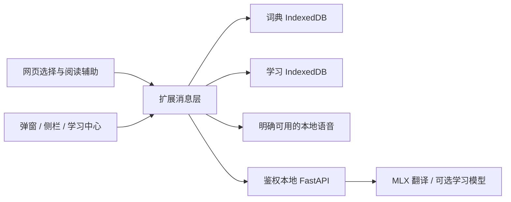

# LocaLingo Learn：英语阅读与词汇学习 PRD

| 项目 | 内容 |
| --- | --- |
| 文档版本 | 1.0 |
| 日期 | 2026-10-20，Australia/Sydney |
| 状态 | 产品设计提案，功能待开发；本文不代表相关能力已经上线 |
| 现有基线 | LocaLingo 0.3.0，提交 `c8e0894` |
| 主要用户 | 以中文为母语、需要大量阅读英语文章、课程材料和技术文档的学习者 |
| 产品主张 | Read to understand. Keep what you learn. 在真实阅读中理解，在真实语境中记住。 |
| 开发目录 | `/Users/yuyangzheng/project/localingo` |

## 1. 产品决策摘要

LocaLingo 从本地网页翻译工具扩展为英语阅读学习助手。核心循环为：**读原文 → 按需查词和理解句子 → 保存有价值的词句 → 主动回忆 → 回到真实阅读**。

建议首个学习版本优先完成六件事：

1. **有来源的离线词典**：查单词、词形和常用短语，词典释义与 AI 解释明确分开。
2. **不打断阅读的查词交互**：选中文字后出现轻量操作条，点击才查询；复杂内容进入侧栏。
3. **渐进式阅读辅助**：默认尝试读英文，按需揭示段落译文；已有双语和仅译文模式继续可选。
4. **带原句的生词本**：保存词义、原句、来源和笔记，支持多义词、多次遇见与去重。
5. **小负担的复习**：先回忆再揭示答案，使用可解释、可暂停的间隔计划。
6. **可迁移的数据**：本地保存、JSON 备份和 Anki 文本导出，避免把学习积累锁在扩展里。

长难句分析、上下文释义、理解检查和跟读作为第二阶段能力。现有 1.7B 翻译模型可以继续负责翻译，但在评测通过前，不把它用于权威词典释义、自动语法判定或考试能力评级。

## 2. 背景：现有能力与学习缺口

### 2.1 已有能力

- Chrome Manifest V3 扩展，原生 HTML/CSS/JavaScript 弹窗与页面内容脚本。
- 本地 FastAPI 服务，默认 `http://127.0.0.1:8765`，令牌验证。
- Apple Silicon 上使用 MLX 运行本地翻译模型。
- 双语对照、仅译文、译文样式、按可见区域翻译、动态内容更新和翻译缓存。
- 右键划词翻译浮层、当前页统计、失败段落重试和恢复原文。

### 2.2 当前缺口

| 用户的问题 | 现有工具的不足 | 产品机会 |
| --- | --- | --- |
| 看到生词，想知道这个词本来的意思 | 划词主要返回译文，没有结构化词典信息 | 词性、词形、释义、来源与发音 |
| 每个单词都认识，整句话仍不理解 | 整段翻译隐藏了结构和逻辑 | 句子意群、修饰关系、指代与连接词解释 |
| 查过很多次还是记不住 | 查询结果没有自然进入复习 | 原句收藏、重复遇见、主动回忆 |
| 一直看中文，读完仍无法独立阅读英文 | 全文双语容易形成依赖 | 按需揭示、英文优先、用户可调整辅助程度 |
| 打开很多页面，学习内容分散 | 翻译缓存不是生词本 | 跨页面学习中心与来源追溯 |
| 本地模型没启动时也想查词 | 现有划词翻译依赖服务和模型 | 将基础词典与学习记录移到扩展本地数据库 |

## 3. 用户、目标与边界

### 3.1 用户假设

用户尚未提供标准化英语等级。以“中文母语、能够阅读部分英语但经常需要词句辅助”为设计起点，覆盖约 A2–C1 的不同需求，不据此给用户贴能力标签。

首次使用只询问可跳过的偏好：阅读领域、解释语言、辅助程度、是否要复习。用户可选“更多中文帮助 / 中英结合 / 尽量英文”，不要求先做测试。

| 场景用户 | 任务 | 最重要的支持 |
| --- | --- | --- |
| 日常大量阅读者 | 新闻、博客、论坛和一般文章 | 快速查词、词组理解、低干扰 |
| 大学学习者 | 课程阅读、论文摘要、教材网页 | 长难句、学术搭配、原句笔记 |
| 技术阅读者 | API 文档、开发文章、AI 论文 | 术语表、保留代码、同一术语一致性 |

### 3.2 产品目标

- 在同一阅读页面完成大部分词句理解，减少切换搜索、词典和笔记软件。
- 给词汇一个具体语境，帮助用户区分“见过这个词”和“理解这个用法”。
- 提供可持续的小量复习，不把阅读变成不断被打断的测验。
- 断网、模型未加载或 Python 服务关闭时，仍能使用已安装离线词典和本地生词本。
- 所有学习信息默认留在本机，外部服务调用由用户主动开启。

### 3.3 首期不做

- 完整课程平台、社交排名、付费课程和考试分数预测。
- 自动评定 IELTS、TOEFL 或正式 CEFR 等级。
- 自动抓取付费词典、越过登录/付费墙或批量保存整本教材。
- 视频字幕提取、PDF OCR、跨设备账号同步和云端学习档案。
- 持续监听麦克风、后台自动跟读评分或强制打卡提醒。

## 4. 成功指标与验证方法

以下为待验证的目标，不是已经达到的性能或学习效果。

| 指标 | 定义 | 首轮目标 / 方法 |
| --- | --- | --- |
| 查词任务成功率 | 选词后找到可理解释义，或得到可操作的未命中说明 | 代表性任务 ≥95%，5–8 名目标用户测试 |
| 查询干扰 | 从出现疑问到回到原文继续阅读的操作数 | 查释义 ≤2 次主动操作，收藏再加 1 次 |
| 上下文保存成功率 | 收藏条目包含用户选择的词义和正确原句 | 验收集 100%；不以不相关页面文字补足 |
| 延迟回忆表现 | 用户自愿参加的 7 天后未看答案词义回忆测试 | 对比用户自己的基线，不承诺固定提升幅度 |
| 阅读理解 | 相近难度材料的要点理解与用户自评 | 小样本试用观察趋势，不只追求读得更快 |
| 查词响应 | 已安装词典的本地查词请求至首屏释义可见 | 热查 P95 ≤200ms，冷查 ≤500ms，需实测 |
| 本地可靠性 | 模型关闭、断网、浏览器重启后词典与生词本可用 | 全部离线用例通过 |

产品不把“查词越多”“收藏越多”“复习连续天数越长”直接视为进步。重复查词可能代表没有掌握，也可能代表词义不同；必须结合语境解释。

主动回忆的设计参考外语词汇实验中的检索练习研究；这支持先回忆、再看答案的方向，并不证明本产品或任意固定间隔一定有效。[Karpicke & Roediger，2008](https://pubmed.ncbi.nlm.nih.gov/18276894/)

## 5. 功能范围与分期

优先级定义：P0 是学习 MVP 的发布门槛；P1 是形成精读能力的重要增强；P2 是验证核心价值后再投入的扩展。

| ID | 功能 | 优先级 | 版本建议 |
| --- | --- | --- | --- |
| D01 | 离线词条、英汉/英英释义与来源 | P0 | 0.4 |
| D02 | 词形还原、多候选和短语检索 | P0 | 0.4 |
| D03 | 快速查词卡片、固定到侧栏 | P0 | 0.4 |
| D04 | 可用本地语音的单词发音 | P0 | 0.4 |
| R01 | 学习阅读模式、按段揭示译文 | P0 | 0.4 |
| V01 | 带语境生词本、编辑、去重 | P0 | 0.4 |
| V02 | 词句学习中心、搜索和筛选 | P0 | 0.4 |
| S01 | 词义回忆与基础间隔计划 | P0 | 0.4 |
| X01 | JSON 备份、恢复、Anki TSV 导出 | P0 | 0.4 |
| A01 | 基于词典候选的上下文释义 | P1 | 0.5 |
| A02 | 长难句和段落逻辑解释 | P1 | 0.5 |
| A03 | 原句挖空、理解问题与反馈 | P1 | 0.5 |
| L01 | 逐句朗读、AB 重复与跟读辅助 | P1 | 0.5 |
| V03 | 学术/技术个人术语表、熟悉词提示 | P1 | 0.5 |
| I01 | 可选在线词典补充 | P2 | 0.6+ |
| I02 | AnkiConnect 手动同步 | P2 | 0.6+ |
| L02 | 用户主动录音、离线识别和发音反馈 | P2 | 0.6+ |
| M01 | 跨设备同步、复杂自适应计划 | P2 | 单独评估 |

0.4 的 P0 不以 AI 深度讲解为依赖。若 AI 分析质量不达标，离线词典、生词本和复习仍可完整发布。

## 6. 信息架构与界面分工

```text
LocaLingo
├── 扩展弹窗：当前页面、阅读模式、翻译控制、打开学习侧栏
├── 页面内：选词操作条、查词卡、按段揭示
├── 学习侧栏：查词 / 精读 / 本页
└── 学习中心（扩展完整标签页）
    ├── 生词与词组
    ├── 收藏句子
    ├── 今日复习
    └── 数据、词典、语音与偏好设置
```

### 6.1 扩展弹窗

延续 0.3.0 暖白、深绿的风格，保持 376px 宽度、正常状态不超过 600px。常用区只放当前页面、阅读方式和主要操作，不放长词条、全文语法或复杂统计。

提供三种阅读模式：“学习阅读 / 双语对照 / 仅看译文”。关闭翻译或“恢复原文”始终可用，不要求模型在线。

- **新用户**：首次推荐学习阅读，可直接改为双语。
- **升级用户**：保留既有双语/仅译文设置，不强制改变阅读习惯。
- 提供“打开学习侧栏”“今日复习 8 条”等入口；数字从本地计划实时计算。

### 6.2 学习侧栏

优先使用 Chrome 原生 Side Panel，建议宽度 360–480px，具体由浏览器和用户窗口决定，不依赖固定宽度。只有用户明确点击才打开，不因为选择文字而自动挤压网页。

第一阶段目标 Chrome 116+，因为从用户交互调用 `sidePanel.open()` 的能力由该版本引入。旧版本或 API 不可用时，提供扩展标签页作为退路。[Chrome Side Panel 文档](https://developer.chrome.com/docs/extensions/reference/api/sidePanel)

侧栏顶端显示当前绑定的页面标题；切换标签页时：未固定的查询跟随当前页，已固定的词卡保持原内容并标注来源。不得把 A 页面的问题用 B 页面上下文解释。

### 6.3 页面浮层

- 选词操作条只提供“查词 / 翻译 / 解释句子”，按照选择内容的类型排序。
- 查词卡宽度约 340–380px，最大不超过视口减去左右各 8px；长内容滚动，不扩展为遮住全文的大弹窗。
- 点击外部或 Esc 关闭；“固定到侧栏”用于保留结果，关闭浮层不会删除已收藏数据。
- 非学习模式下不显示额外常驻工具栏；划词入口由用户偏好控制。

## 7. 核心阅读旅程

### 7.1 读文章、查词、继续阅读

1. 用户读英文，在不理解的词上双击或拖选。
2. 保留浏览器原生选择，旁边出现轻量操作条，不立即发起网络或模型请求。
3. 点击“查词”，立即显示本地词典首屏信息。
4. 用户可以听发音、展开其他词义、点击“本句意思”或保存生词。
5. Esc 关闭后，阅读位置不变，焦点回到合理的触发位置。

默认不因悬停任何英文单词就自动弹卡，避免大量阅读时不停闪烁。自动选词查词可以作为显式开启的高级偏好。

### 7.2 看懂长句

1. 选择句子后点击“解释句子”，侧栏打开并明确列出原句。
2. 先给一句简短解释，再按需展开意群、主干、修饰、指代、连接关系。
3. 同时提供“只看翻译”，用户不用读完所有语法术语。
4. 保存的是用户选中的句子及笔记，不自动保存整页。

### 7.3 从查词进入复习

1. 用户选择一个词义，点击“加入生词本”。
2. 卡片显示“已保存 · 可撤销”；不弹出新页面强迫填写字段。
3. 原句、来源和首次遇见时间自动附带；可立即编辑释义和标签。
4. 稍后在学习中心完成一组小量复习。
5. 再次遇到该词时，可查看以前的原句或标记本次是新词义。

## 8. D01–D04：词典需求

### 8.1 查询类型与边界

| 输入 | 首选处理 | 规则 |
| --- | --- | --- |
| 单个英文词 | 词典查词 | 去除外围标点，保留原始拼写与大小写展示 |
| 2–8 个词的短语 | 短语精确查找，再给拆词入口 | 不把所有空格文本都当成单词 |
| 变形词 | 原词精确查找 + 词形候选 | 词形库优先，不能只靠删后缀 |
| 完整长句 | 句子解释 / 翻译 | 不自动把整句加入单词本 |
| 中文、代码或超过范围的选择 | 提示可用操作 | MVP 不做中英反查；代码不自动解释为英语词汇 |

查询文本最大 300 字符；超长内容显示“改用句子解释”。选词只包含空格时不显示操作条。超长 token、URL、邮箱和变量名默认不当作普通词条查询。

### 8.2 词条卡的首屏信息

首屏顺序：词头与词形 → 可用音标/发音 → 词性 → 简明英英释义 → 中文辅助 → 当前原句 → 加入生词本。单次默认只展示最相关的 1–3 个词义，其余可展开。

数据来源必须可见。没有可用音标或例句时直接省略，不由模型编造后当作词典数据展示。等级、考试标签、词频只在来源明确时显示；来源的词频标签不等于用户水平或词义难度。

### 8.3 词形与多义词

- `studies` 可以关联到 `study`，保存时保留遇到的实际词形。
- `saw` 不能无条件替换成 `see`；展示动词过去式和名词等候选。
- `bank` 的金融机构与河岸义项分开管理，不能因拼写相同覆盖用户已保存词义。
- `take into account` 优先作为短语保存，不默认拆成四张单词卡。
- 区分大小写敏感的缩写、专名和一般词。规则还原失败时不展示虚假的唯一“原形”。

### 8.4 本句意思：可选 AI 增强

0.5 版本将词典候选释义、选择词和最多约 2 句邻近上下文传给本地模型，要求选择候选义项或返回“不确定”。解释卡明确标注“AI 结合本句解释”，与“词典释义”分区。

如果候选不充分、输出不合法或模型没有把握：展示现有词条并提示“暂时无法确定本句词义”，不生成一个看起来权威的答案。未经用户确认的 AI 释义不自动成为复习标准答案。

### 8.5 发音

P0 支持明确可用的本地英语 TTS 语音；按实际语音元数据区分口音，不把普通合成音标成真人英/美发音。无合适离线声音时说明原因，并提供系统语音安装指引。

Chrome 的语音对象可带 `remote` 标记；本地模式仅选择已确认本地的声音，未知来源声音不悄悄启用。远程语音必须另行启用并明确告知文字会发送到外部。[Chrome TTS 文档](https://developer.chrome.com/docs/extensions/reference/api/tts)

- 单词和原句发音均由点击触发，不自动播放。
- 同一时间只播放一段，播放新内容时停止上一段。
- 支持正常/慢速预设，第二阶段扩展连续调速和逐句播放。
- 词典真人音频仅在音频本身的授权和来源明确时引入；词条文本许可不自动覆盖外链音频。

## 9. R01：学习阅读模式

### 9.1 交互规则

学习阅读默认显示英文原文。用户把鼠标移到可翻译段落时出现轻量“看译文”入口；键盘和触屏也有可到达的段落操作入口，不依赖 hover。

点击后才翻译该段，译文出现在段下。按钮变为“收起译文”，并提供“解释这句/段”入口。未点击的其他段落不会因此自动排入模型队列。

普通链接、文本选择、浏览器查找、表格、代码和表单继续保持原行为。链接中的词只能通过明确选词操作查询，不拦截正常链接点击。

### 9.2 辅助程度

| 偏好 | 表现 |
| --- | --- |
| 更多中文帮助 | 查词卡先显示简明中文与英文释义，段落译文易于发现 |
| 中英结合 | 英英释义在前，中文辅助默认显示 |
| 尽量英文 | 英英释义在前，中文点按揭示；不自动提高阅读难度 |

所有模式允许随时看中文。不把查看翻译当作失败，也不显示带羞辱意味的“作弊次数”。

### 9.3 熟悉词提示

P1 允许用户显式标记“熟悉 / 学习中 / 不再提醒”。仅对用户保存的条目显示轻量点状下划线，每屏控制密度；可一键关闭。

不对全页陌生词做高成本逐词模型判断，不因为某词被看见就自动标为掌握。高亮密度控制、正文 DOM 扫描和主题适配必须经过性能测试。

## 10. V01–V02：生词本、词组与句子收藏

### 10.1 保存内容

每个学习条目至少包含：词头/短语、遇见的实际词形、词性、选定词义、释义来源、原句、来源标题和链接、保存时间、学习状态。标签、个人笔记和发音偏好可选。

在没有上下文的独立查词界面也可收藏；原句为空时显示“未关联原句”，不伪造网页来源。

### 10.2 去重与新词义

按规范化词头/短语 + 词性 + 词义标识识别已有学习项。连续双击保存使用幂等键，不能创建两条记录。

再次收藏同一词义时：显示已有条目，追加新的遇见记录，而不是覆盖原句。相同页面同一句不重复堆积；默认保留最近 20 条不同语境，可由用户删除或提高上限。

不同词义可以新建学习项。AI 自拟或用户自写释义使用独立自定义义项 ID，并标注来源类型。

### 10.3 学习中心

- 顶部搜索框覆盖词头、短语、释义和个人笔记。
- 筛选：学习中、熟悉、暂停、收藏句子、标签、来源网站和待复习。
- 每条卡片默认显示词头、简义、最近遇见原句和下次复习时间。
- 编辑中文或英文释义不会直接修改原词典；个人释义另存一层，可恢复词典版本。
- 删除条目进入本地回收区 30 天，可恢复。永久清空需再次确认。
- 已保存内容可以在网页关闭、Python 服务停止和断网后继续使用。

### 10.4 来源定位

保存文本引文、前后短语和页面指纹，作为回到原句的线索。默认清理 URL 查询参数和 fragment，避免保存带令牌的私人 URL；确需参数定位时由用户选择保留。

页面变化后若无法唯一匹配原句，打开来源并显示“原句位置已变化”，不高亮错误位置。对登录态内容只保存用户主动收藏的片段，不抓取整页存档。

## 11. S01：复习系统

### 11.1 复习原则

- 先展示提示，让用户尝试回忆，再点击或按空格揭示答案。
- 复习题优先使用用户保存的真实原句和选定词义。
- “熟悉”由用户决定；一次正确或打开过释义都不自动等于掌握。
- 初期使用透明、版本化的简单计划，不把它包装成个性化记忆预测模型。
- 提供暂停、推迟和减少每日量，复习积压不阻止查词和阅读。

### 11.2 P0 题型

**语境词义卡**：显示原句并突出目标词，先回忆它在本句中的意思，再揭示选定释义。支持独立词卡，没有原句时如实展示。

P1 再加入原句挖空和短语填空。多义词卡必须明确考查具体语境，不能把另一合理词义直接判错。

### 11.3 回答与调度

答案揭示后显示“忘记 / 困难 / 记得 / 很熟”。P0 采用自评；记录揭示前是否输入过答案、是否先看过提示，避免把纯查看次数当作正确回忆。

基础间隔序列：1、3、7、14、30、60 天。`scheduler_version = simple-v1`，不声称等同于 Anki 的任何调度算法。

| 当前状态 | 忘记 | 困难 | 记得 | 很熟 |
| --- | --- | --- | --- | --- |
| 新词或重新学习 | 10 分钟后，仍处学习阶段 | 1 天后，仍处学习阶段 | 1 天后，进入复习 level 0 | 3 天后，进入复习 level 1 |
| 复习 level n | 转重新学习，10 分钟后 | 保持 level，间隔为当前级别天数的一半向下取整，至少 1 天 | 升 1 级，最多 level 5 | 升 2 级，最多 level 5 |

“忘记”不会删除历史；重学后再次“记得”从 1 天恢复，不跳到更长间隔。同一复习操作只能写入一次事件，双击或重发不重复推进计划。

### 11.4 负担控制与时间

默认每天最多引入 5 个新条目，提供约 5 分钟、最多 20 条的轻量复习入口；用户可以调整。到期项优先，不为了填满配额强加新词。10 分钟后的重学项到时才出现，不强迫用户等待。

提醒默认关闭。后台日期判断使用用户时区，实际到期时间使用 UTC 时间戳。跨时区、系统时间变化和浏览器休眠不能把条目丢失或重复出题。

## 12. A01–A03：精读与理解辅助（P1）

### 12.1 句子解释层次

用户选择句子后，默认只呈现“这句话在说什么”；以下模块按需展开：

1. **意群分块**：按主干与修饰拆成可阅读片段，保留原词序。
2. **句子主干**：给出主语、谓语、必要宾语/补语，并用日常中文解释。
3. **修饰与从句**：说明哪个成分修饰什么、从句承担什么作用。
4. **指代与逻辑**：解释 it/this/which 等可能指向，以及转折、因果、让步关系。
5. **关键表达**：短语、搭配与可替换表达，说明是否改变语气或含义。

依赖前文才能判断的指代，须标出“需要更多上下文”。模型给出的句子跨度必须能映射回原句，映射失败时使用纯文本解释，不在网页上乱划结构。

### 12.2 简化与要点

- “用更简单的英语解释”返回保留原意的短说明，标注为 AI 改写。
- 不把简化文本替换掉原文，也不把改写自动用于引用或收藏原句。
- 段落要点优先呈现 1–3 条，不默认总结整篇文章。
- 分析会损失限定条件或模型不确定时，提示对照原文。

### 12.3 理解检查

用户主动选择“检查我的理解”，每次提供 1–3 个问题，可选主旨、指代或推理，不在用户每读完一段时强制弹测验。

每题保存支持答案的原文片段。不能找到证据时不生成题目。自由回答仅给参考反馈，允许“我认为答案也合理”和报告问题；不以模型自信度判定用户英语水平。

AI 生成题目和解释须经过单独质量门槛，不能因为翻译测试通过就直接放行。

## 13. L01–L02：听读与跟读

P0 单词与原句点按发音；P1 加入逐句朗读、当前句高亮、暂停/继续、前后句、慢速和 AB 重复。用户滚动或选词时不强制自动跟随滚动。

跟读第一步采用“先听原句 → 暂停自己跟读 → 再听对照”，无需麦克风，也不伪造发音评分。

P2 才评估主动录音、离线识别和反馈。录音必须可见地开始/停止，关闭界面时停止采集，原始录音默认不保存。单纯 ASR 转写匹配不能称为专业发音诊断。

## 14. 关键界面线框

### 14.1 快速查词卡

```text
┌──────────────────────────────────────┐
│ account for              固定到侧栏 × │
│ 短语 · 来自已安装词典       ▶ 发音    │
│                                      │
│ [简明英文释义]                       │
│ 在该义项中：解释……的原因             │
│                                      │
│ 原句：The report accounts for ...    │
│ [本句意思] [其他词义]                 │
│                                      │
│ [＋ 加入生词本]               详细 ↗ │
└──────────────────────────────────────┘
```

线框中的释义和原句只是布局示例；实际展示必须使用真实来源或明确标注的生成内容。

### 14.2 学习侧栏

```text
┌──────────────────────────────────────┐
│ LocaLingo               今日复习 8 ↗ │
│ [查词]      [精读]      [本页]       │
│                                      │
│ 查一个词或短语……                     │
│                                      │
│ 原句 / 当前选中内容                  │
│ 词典释义                             │
│ AI 本句解释（按需请求）               │
│ 来源与个人笔记                       │
│                                      │
│ [加入生词本]   [打开学习中心]         │
└──────────────────────────────────────┘
```

### 14.3 复习页

```text
LocaLingo / 今日复习          3 / 10   结束本次

原句：... [目标表达] ...
先想一想，它在这句话中是什么意思？

[可选：输入你的理解……]
[显示答案 · Space]

揭示后：词典义项 / 你的笔记 / 来源
[忘记 · 1] [困难 · 2] [记得 · 3] [很熟 · 4]
下一次：10 分钟 / 1 天 / 3 天……（按当前状态计算）
```

快捷键只在对应卡片区域获得焦点时生效，输入框中输入数字或空格不触发评分。现有 Alt+T 保持翻译开关；查词快捷键通过 `chrome.commands` 配置，不硬占浏览器常用快捷键。

## 15. 状态、错误与无障碍

| 状态 | 用户看到什么 | 可继续做什么 |
| --- | --- | --- |
| 词典未安装 | 尚未安装词典 + 安装/导入入口 | 查看已有生词、使用现有翻译 |
| 本地未命中 | 未找到该词条，显示可选词形和拆词查询 | 手动搜索、请求标明来源的 AI 解释 |
| 模型未加载 | 词典正常；AI 区提示首次加载 | 继续读词典，主动取消等待 |
| Python 服务离线 | 只有 AI 区不可用 | 离线查词、生词本、发音（本地声音）、复习照常 |
| 音频不可用 | 没有可用本地英语声音 | 查看文字、安装声音或明确启用在线声音 |
| 收藏写入失败 | 保存失败，保留用户正在编辑的内容 | 重试、复制内容、导出可用数据 |
| 原句所在 DOM 改变 | 原句位置已变化 | 保留文本收藏，取消错误高亮 |
| AI 输出无法校验 | 解释暂不可用，不展示半成品结构 | 查看词典、看翻译、重新请求 |
| 存储接近上限 | 明确大小、词典包和学习数据占用 | 清理可再下载词典、导出学习数据 |

交互要求：

- 快速连续查词采用请求 ID；旧结果不得覆盖新词卡。
- 浮层在视口上下左右避让，滚动和缩放时跟随锚点或关闭；锚点失效不留下悬空卡。
- 鼠标选词不抢走文本编辑焦点；键盘触发后结果卡有可预测的焦点顺序，Esc 后合理返回。
- 学习侧栏不困住键盘焦点；按钮有可读名称，状态变化使用节制的 aria-live。
- 正文最小字号跟随网页或用户偏好；工具界面正文建议 14px 起，辅助文字不小于 12px。
- 支持深浅色、系统减少动画偏好、200% 缩放和窄窗口；含义不只依赖颜色。

## 16. 词典数据方案、来源与质量

### 16.1 数据源决策

| 来源 | 定位 | 条件与限制 | 建议 |
| --- | --- | --- | --- |
| ECDICT | 候选离线英汉基础库 | 上游提供释义和词形等字段，仓库声明 MIT；同时 README 记录多来源汇集，发布需对实际采用文件和来源清单做核查 | 优先做导入原型，冻结版本、校验和与许可快照 |
| WordNet | 英英义项、词形和语义关联补充 | 按 Princeton 许可保留版权与声明；不是完整英汉学习词典 | 合适的离线补充或英英降级方案 |
| 用户自己有权使用的词典 | 个人补充 | 仅本机导入，不替用户公开重分发 | 后续开放受支持格式 |
| Free Dictionary API 等在线来源 | 可选英英补全 | 免费接口不代表文本、音频都可无限缓存或再分发；有网络依赖 | P2，明确授权、最小请求与故障退路 |
| 本地模型 | 上下文解释、简化与示例 | 可能出错，生成内容单独标注 | 不填充“词典权威字段” |

来源：[ECDICT README](https://github.com/skywind3000/ECDICT)、[ECDICT LICENSE](https://raw.githubusercontent.com/skywind3000/ECDICT/master/LICENSE)、[WordNet 许可](https://wordnet.princeton.edu/license-and-commercial-use)、[Free Dictionary API](https://dictionaryapi.dev/)。

首个发布门槛是获得可采用的数据包，而不是默认把第三方全部词库打进仓库。若英汉数据包未完成核查，应明确推迟英汉离线包，不以未标注的 AI 释义伪装已上线的词典。

### 16.2 数据包规范

每个词典包包含 `source_id`、上游 URL、版本/提交、文件 SHA-256、许可文本、来源声明、字段说明、导入器版本和质量抽样记录。文本、音频和附加标签的授权范围分别记录。

导入在 Worker 中分批执行，显示进度，可取消；失败不破坏原词典。基础包与完整包分开，先基于实际构建结果给出下载大小，不预先承诺任意容量。核心库优先覆盖常用词及常见词形，不以收词量作为唯一质量指标。

默认流程：从产品文档获得通过审核的数据包 → 用户选择本地文件导入 → 校验 → 建立索引 → 可用。在线下载更新作为单独选项，明确来源域名和大小。

### 16.3 质量要求

- 200 条以上人工核对的基础集，覆盖变形、多义、词组、罕见词、大小写和未命中。
- 词典原始字段与规范化字段可追溯，不能因清洗把不同词条强行合并。
- 来源缺少例句、音标、等级时保留缺失状态。
- 用户修正进入个人覆盖层，不回写供应商数据或自动上传。

## 17. 模型职责与生成质量门槛

| 任务 | 主要实现 | 模型要求 |
| --- | --- | --- |
| 词典查询、词形、保存、调度 | 确定性逻辑与数据索引 | 不需要模型 |
| 段落翻译 | 现有 MLX 翻译路径 | 保留现有翻译回归集 |
| 上下文义项选择 | 词典候选 + 受约束结构化输出 | 输出候选 ID 或 unknown，需单独评测 |
| 句子讲解 | 面向解释任务的合适本地指令模型 | 不默认沿用翻译微调模型，先做对比评测 |
| 测验与反馈 | 原文证据 + 校验 + 用户可质疑的反馈 | 不输出正式能力诊断 |

结构化输出包含证据范围、生成来源、模型版本和提示词版本。AI 自报 confidence 不作为已校准概率展示。

0.5 发布建议门槛：至少 100 条专家/熟练使用者核对的句子集；可定位证据跨度 100% 合法；结构化响应校验成功率 ≥99%；语义严重错误率 ≤2%（记录样本量与分类方式）。未达到门槛则继续实验入口，不给所有用户默认开启。

用户高频点击的解释优先于后台翻译排队，但不声称能够中途抢占当前 MLX 生成。任务排队、取消和超时结果采用请求 ID；取消后旧结果不能重新插入 DOM 或复活已删除的学习数据。

## 18. 本地架构与权限

### 18.1 架构选择

基础词典与学习记录的权威存储放在**扩展自身来源的 IndexedDB**。普通网页脚本不能直接读写该数据库，页面内容脚本通过受校验的扩展消息访问它。



Python 服务只承担需要模型的任务。因此“断网”和“服务未启动”都不应让基础查词、已保存内容和复习失效。

### 18.2 现有项目演进

- `content.js` 保留正文翻译职责，增加选词/段落交互适配，避免直接管理学习数据库。
- 在扩展中新增独立的 `learning/` 数据访问、词典检索和复习调度模块。
- 浮层 UI 使用隔离样式的容器；正文译文继续继承页面排版。
- 新增侧栏和学习中心页面；复用现有暖白/深绿样式变量，不为此重写整个项目框架。
- MV3 后台被回收后可以从 IndexedDB 恢复，不能依赖内存中的唯一学习状态。
- Python 新增学习分析任务接口，不把大型词典包、个人学习 DB 或模型权重提交 Git。

### 18.3 权限预算

保留已有权限和本地 host permissions。原生侧栏和 TTS 按实现增加对应权限，并在升级说明中解释用途。首期不需要麦克风、通知、远程全部域名或额外剪贴板读取权限。

远程词典若引入，使用特定来源的可选 host permissions，不扩展成对任意地址发请求。现有 token 继续只放在本机，不进入日志、导出文件或 Git。

## 19. 数据模型

所有实体包含 `schema_version`。ID 使用稳定本地 ID；时间使用 UTC，显示按用户时区。

| 实体 | 关键字段 | 作用 |
| --- | --- | --- |
| DictionaryPackage | source_id, version, checksum, license_ref, imported_at | 来源与更新追溯 |
| Lexeme | id, normalized_form, display_form, kind, part_of_speech, forms | 词头、词形和短语 |
| DictionarySense | id, lexeme_id, source_id, source_version, definition_en, gloss_zh, phonetic | 来源明确的释义 |
| LearningItem | id, lexeme_key, sense_ref, chosen_gloss, meaning_source, user_confirmed, status, tags, note | 用户真正学习的义项 |
| Encounter | id, item_id, surface_form, sentence, quote_anchor, source_url, source_title, seen_at | 同一词的不同真实语境 |
| ReviewCard | id, item_id, type, prompt, answer_snapshot, scheduler_version, stage, level, due_at | 可复现的复习提示与答案 |
| ReviewEvent | id, card_id, session_id, shown_at, revealed_at, rating, prior_state, next_state | 调度审计与统计 |
| SavedSentence | id, original_text, user_note, source_ref, analysis_snapshot | 句子收藏 |
| AnalysisCache | request_key, model_version, prompt_version, source_hash, result, created_at | AI 输出缓存，不混入词典真值 |

### 19.1 保存快照与版本

复习卡保存当时选定释义的快照。词典更新不静默更改旧卡答案；需要时提示用户查看新版本并自行更新。

个人修改与原始词典字段分层。生成解释必须保留 `meaning_source=ai`；用户手动改写为自己的笔记，也不应被包装成上游原文。

### 19.2 一致性

- 保存学习项与首次 Encounter 在同一事务完成。
- 更新到期时间与写入 ReviewEvent 在同一事务完成。
- 提供 idempotency_key，重复提交不新增卡或推进两次调度。
- 数据库升级先建立可恢复备份，迁移失败回滚，不清空旧数据重新初始化。
- 页面删除、条目删除和迟到的模型响应通过版本/删除标记校验，不能复活已删除内容。

## 20. 消息与 API 草案

以下为拟定接口，不表示现有服务已经实现。

### 20.1 扩展内部消息

| 消息 | 输入 | 输出 |
| --- | --- | --- |
| `learning:lookup` | request_id, query, 可选 sentence | 词头候选、词义、来源、可用发音状态 |
| `learning:save` | idempotency_key, 选定义项、用户上下文 | item_id, created/updated/already_exists |
| `learning:list` | 搜索、筛选、游标、limit | 本地分页条目 |
| `learning:review-next` | session_id, 当前时间 | 到期卡或本次已完成 |
| `learning:review-rate` | event_id, card_id, rating, version | 新计划和下一次时间 |
| `learning:export` | 选定范围、JSON/TSV | 可下载文件描述 |

页面脚本请求不能直接读写任意存储键。消息验证字符串长度、类型、来源标签页和幂等标识。单次列表默认 50 条，不把整个学习库发到每个网页。

### 20.2 本地模型任务

- `GET /capabilities`：服务版本、模型是否可用、支持的学习任务；不暴露令牌。
- `POST /learning/tasks`：显式请求上下文释义、句子分析或理解问题，返回任务 ID。
- `GET /learning/tasks/{id}`：排队、运行、完成、失败、已取消及结果。
- `DELETE /learning/tasks/{id}`：取消队列或标记运行任务结果废弃；是否能终止实际计算需明确返回。

全部学习任务接口使用现有鉴权方式；每个任务绑定发起端上下文，不通过公开 `/health` 返回原文。

请求示例：

```json
{
  "request_id": "example-request-001",
  "task": "context_sense",
  "selection": "accounts for",
  "sentence": "This change accounts for the difference in the results.",
  "candidates": [{"sense_id": "example:account-for:explain", "meaning": "解释原因"}],
  "explanation_language": "zh-CN"
}
```

上下文最多 8000 字符，单次最多分析 1 个句子或用户选择的有限段落；超出返回可操作的 413 提示。网页内容只作为待分析材料，不作为系统指令，不执行其中包含的工具调用要求。

## 21. 数据隐私、备份与外部集成

### 21.1 默认行为

- 单纯选中文字不记录学习历史；只有主动收藏、复习和用户开启的学习统计才持久化。
- 不自动保存整页 HTML、登录内容、访问 token 或输入框文字。
- 无痕会话默认不持久化；如提供“保存到普通学习库”，必须由用户主动选择并说明目的地。
- 查词历史、阅读统计和站点排除规则分别开关；排除站点不显示学习操作条。
- 云端同步与在线词典默认关闭，不能在本地失败时自动发送原句到云端。

### 21.2 备份与恢复

JSON 为完整备份格式，包括版本、条目、语境、复习事件和来源标识，不包含 token 和完整第三方词典包。导入前展示条目数和合并策略，校验 schema 与大小；损坏文件不覆盖当前库。

扩展卸载/浏览器资料删除会影响本地数据，首次创建学习库和数据设置中明确说明，并提供手动备份入口。

### 21.3 Anki 导出

P0 使用 UTF-8 TSV 文本导出，列包含稳定条目 ID、词头、词义、原句、来源链接、标签。提供字段映射说明；可选挖空导出只在用户确认的原句中生成，正确转义制表符、换行和 HTML。

Anki 官方支持 UTF-8 分隔文本导入，字段数量与映射需要保持一致。[Anki 文本导入文档](https://docs.ankiweb.net/manual/importing/text-files)

P2 的 AnkiConnect 连接不得直接假设 8765 就是 Anki。已归档上游配置的默认端口为 8765，与 LocaLingo 当前默认值相同；当前上游仓库已迁移，实际集成须重新核对目标版本。通过可配置端口和协议握手识别服务，不静默改动用户端口。[上游历史配置](https://raw.githubusercontent.com/FooSoft/anki-connect/master/plugin/config.json)、[仓库迁移说明](https://github.com/FooSoft/anki-connect)

## 22. 性能和资源预算

测试基准先固定为 Apple Silicon、16GB 内存的参考设备，并记录具体机型、系统和 Chrome 版本。用户设备未知，所有数字在上线前需实测。

| 项目 | 目标 |
| --- | --- |
| 离线词典热查询 | P95 ≤200ms |
| 查询卡响应 | 点击后 ≤100ms 出现骨架，数据随后填充 |
| 词典缺失/未命中 | ≤500ms 给出明确状态，不一直转圈 |
| 生词保存 | 本地持久化完成后才显示成功；通常 ≤300ms |
| 10000 学习项搜索 | P95 ≤300ms，使用索引和分页 |
| 页面影响 | 不全页反复扫描；任务分片，避免新增超过 50ms 的主线程长任务 |
| AI 耗时 | 区分排队与生成；先展示已有词典信息，不等待大模型才能查词 |
| 词典导入 | Worker 分批处理，可取消；不阻塞正文滚动 |
| 内存 | 不将整份词典常驻加载到每个标签页；侧栏关闭可释放临时结果 |

切换模型前显示需要的磁盘和预计资源范围，不同时无提示加载多个大模型。学习分析按需调用，避免每个单词 hover 都触发推理。

## 23. 验收标准

### 23.1 P0 功能验收

| 用例 ID | 场景 | 通过条件 |
| --- | --- | --- |
| AC01 | 首次没有词典 | 显示安装入口，不假装查词成功 |
| AC02 | 正常查一个词 | 有来源、释义和可用操作，关闭后位置不变 |
| AC03 | `studies` / `saw` | 正确保留词形；歧义有候选，不强制错误原形 |
| AC04 | 短语查找 | 优先短语候选，不直接拆成多个收藏 |
| AC05 | 同词不同义项 | 可分开保存，不覆盖原语境 |
| AC06 | 断网且服务关闭 | 已安装词典、生词本、复习可用 |
| AC07 | 无本地声音 | 显示不可用，不偷偷调用远程声音 |
| AC08 | 学习阅读模式 | 只翻译主动揭示的段落；其他段落不排队 |
| AC09 | 阅读模式升级 | 保留已有用户设置 |
| AC10 | 收藏双击和重发 | 只产生一个学习项/一次 Encounter |
| AC11 | 相同词的新语境 | 追加上下文，保留旧句和用户笔记 |
| AC12 | 连续快速选 A/B 两词 | A 的迟到结果不覆盖 B |
| AC13 | 翻页与 SPA 切换 | 查询与语境不串页面 |
| AC14 | 词卡锚点移除 | 不报错、不高亮错误位置 |
| AC15 | 恢复原文 | 移除阅读辅助，不删除生词本 |
| AC16 | 复习先看答案 | 评分按钮只在揭示后出现；记录提示使用 |
| AC17 | 双击复习评分 | 只写一条事件、推进一次计划 |
| AC18 | 忘记后重学 | 10 分钟后重新出现，学习进度符合调度表 |
| AC19 | 跨时区与休眠 | 时间显示正确，无漏卡或重复事件 |
| AC20 | 浏览器重启 | 已持久化词句与复习进度保留 |
| AC21 | JSON 恢复 | 导入结果可核对，重复导入不重复创建 |
| AC22 | 真实 Anki 导入 | 中文、制表符、换行、标签和字段映射正确 |
| AC23 | 词典更新失败 | 保留原可用版本，学习答案不被更改 |
| AC24 | 删除与恢复 | 30 天回收区可恢复，清空有确认 |
| AC25 | 恶意页面内容 | 不执行指令、HTML 或未知工具调用 |
| AC26 | 键盘和读屏 | 所有主要操作可达，关闭焦点合理 |
| AC27 | 200% 缩放、暗色、窄窗口 | 文案和按钮不溢出，内容可滚动 |
| AC28 | 普通网页交互 | 代码、表单、导航、链接与原生选择不被破坏 |

### 23.2 P1 额外门槛

- 同一句话在不同语境中查询，证据和解释不混用。
- 模型不确定或输出异常时有明确退路，不显示半解析语法树。
- 每个理解问题都有原文证据；开放题允许合理多答案与申诉。
- 取消解释后旧响应不能覆盖新任务；排队状态真实反映等待。
- 语音播放可暂停停止，关闭页面不继续播放或采集录音。

## 24. 开发任务与里程碑

估算假设：1 名熟悉现有扩展和 Python 的开发者，使用现有 UI 基础，单平台 Chrome + macOS。以下是有效开发工作日区间，不是日历承诺，且可能因词典数据与模型评测结果调整。

| 里程碑 | 产物 | 依赖 | 初步估算 |
| --- | --- | --- | --- |
| M0 数据验证 | 词典来源清单、样例导入、100–200 条查询/词形核对 | 数据包获取与采用条件明确 | 2–4 天 |
| M1 查词闭环 | IndexedDB、查询、选词卡、来源、发音退路 | M0 | 4–6 天 |
| M2 阅读与积累 | 侧栏、学习模式、原句保存、多义去重与搜索 | M1 | 4–6 天 |
| M3 复习与迁移 | 调度、复习 UI、备份恢复、Anki 导出 | 稳定的数据模型 | 4–6 天 |
| M4 发布硬化 | 迁移、兼容、无障碍、性能与真实 Chrome 回归 | M1–M3 | 3–5 天 |
| M5 精读试验 | 上下文解释、句子分析和题目质量评测 | 单独模型与评测集 | 另行估算 |

0.4 约 17–27 个有效开发工作日。若先验证个人使用，可在 M1–M2 做小范围试用；未完成备份、数据恢复与基础回归前，不宣布完整学习 MVP 发布。

建议每个里程碑独立提交与推送，并保留验收截图、测试结果与数据迁移说明。文档、词典构建器和示例数据可以进 Git；真实个人学习记录、访问令牌、模型权重与大词典包不进仓库。

## 25. 风险与决策清单

| 风险 / 待确定项 | 当前设计决定 | 重新评估条件 |
| --- | --- | --- |
| 用户水平未知 | 提供可跳过的辅助偏好，不自动评级 | 用户试用反馈和阅读材料样本 |
| 词典数据来源复杂 | 冻结采用版本与字段来源，发布前核查 | 数据包更换或商业分发范围变化 |
| 1.7B 解释质量不足 | 词典与规则优先，深度解释通过评测才开放 | 候选模型对比集达标 |
| 翻译和学习任务抢占资源 | 按需请求，先给词典结果，显式排队 | 有真实等待数据后优化队列/取消 |
| 生词库越来越大 | 索引、分页、幂等事务、备份与可恢复删除 | 10000 条压力测试和长期使用 |
| 用户只收藏不复习 | 少量新卡、原句回忆、可选会话结束提示 | 两周试用后再调整引导 |
| 复习积压造成压力 | 每日上限、暂停与推迟，不阻止阅读 | 用户明确希望强化训练 |
| 端口冲突 | Anki 首期走文件导出 | 开发直接集成时验证当前协议与端口 |
| 网站更新造成定位失效 | 保留文本引文，失败时不错误高亮 | 大站兼容测试与真实故障 |

## 26. 第一阶段可直接进入开发的用户故事

1. 作为英语学习者，我希望选中一个词就能看到有来源的释义，以便不离开文章就继续阅读。
2. 作为阅读者，我希望先读原文，遇到困难时只揭示这一段的中文，而不是提前看到整篇译文。
3. 作为词汇学习者，我希望保存当前义项与真实原句，下一次再遇到它时知道自己以前在哪里见过。
4. 作为复习者，我希望先想起词义，再看答案，并按自己的实际感受安排下一次复习。
5. 作为本地工具用户，我希望模型没启动也能查词和复习，且可以导出全部积累。

**建议首个可用原型**：离线查词卡 + 原句收藏 + 简单复习页。先验证这三个动作是否被持续使用，再投入高成本的 AI 语法与生成练习。

## 27. 参考资料与核实范围

核实日期：2026-10-20。外部服务、数据版本和许可可能变化，开发采用时需针对实际文件再次冻结与验证。

- [Chrome Side Panel](https://developer.chrome.com/docs/extensions/reference/api/sidePanel)：侧栏及用户手势打开限制。
- [Chrome TTS](https://developer.chrome.com/docs/extensions/reference/api/tts)：语音能力与远程语音标记。
- [ECDICT](https://github.com/skywind3000/ECDICT) 与 [LICENSE](https://raw.githubusercontent.com/skywind3000/ECDICT/master/LICENSE)：字段、词形和项目许可声明。
- [WordNet 许可](https://wordnet.princeton.edu/license-and-commercial-use)：数据使用与保留声明要求。
- [Free Dictionary API](https://dictionaryapi.dev/)：在线英英接口示例；本文不据此认定返回媒体均可自由再分发。
- [Anki 文本导入](https://docs.ankiweb.net/manual/importing/text-files)：UTF-8 与字段映射。
- [AnkiConnect 历史端口配置](https://raw.githubusercontent.com/FooSoft/anki-connect/master/plugin/config.json) 与 [迁移说明](https://github.com/FooSoft/anki-connect)：只用于识别已有端口冲突风险，不等于当前上游全部行为的保证。
- [Karpicke & Roediger，2008](https://pubmed.ncbi.nlm.nih.gov/18276894/)：外语词汇检索练习实验，对复习交互的设计参考。
